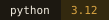
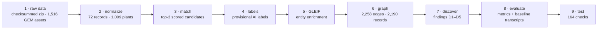

<div align="center">
  <picture>
    <source media="(prefers-color-scheme: dark)" srcset="assets/banner-dark.svg">
    
  </picture>

  <p><sub><b>Every edge cites its evidence.</b> AidData CLG-LMIC v1.0 × GEM Ownership Tracing API × GLEIF, pointed at Chinese-financed Indonesian power plants.</sub></p>

  <p>
    
    
    
    
  </p>
</div>

## The claim on the box

Reversibility, precisely stated: every graph edge is required by tests to cite at least one evidence id that resolves to a record quoting its exact source value (structural property, test-enforced over all edges), and the inspector renders those chains. The docs' prose claims cite these artifacts but have not themselves been exhaustively audited; treat narrative statements as secondary to the JSON artifacts.

## Case flow — raw data to findings



**Run the whole chain** (raw → processed → findings → tests):

```bash
bash scripts/run_all.sh
```

Tests alone, from a clean project root (no PYTHONPATH needed — `tests/conftest.py` puts `src/` on the path):

```bash
.venv/bin/python -m pytest tests -q          # 164 pass · 1 skips without data/http_cache
# or, from a fresh checkout:
uv venv --python 3.12 .venv
uv pip install --python .venv/bin/python -r requirements.txt
.venv/bin/python -m pytest tests -q
```

### Exhibit A — the nine stations

All steps idempotent; network calls cached in `data/http_cache/`, every request logged in `data/processed/api_request_log.jsonl`.

| step | command | output |
|---|---|---|
| 1. raw data | `scripts/download_aiddata.sh`, `scripts/fetch_gem.py`, `scripts/fetch_gem_sample.py` | `data/raw/` (checksummed zip; 1,516 GEM assets; 26 matched-plant location details) |
| 2. normalize | `python -m discovery.normalize` | `data/processed/aiddata_idn_energy.json` (72 records), `gem_idn_plants.json` (1,009 plants, unit→plant with per-status capacity) |
| 3. match | `python -m discovery.matching` | `data/processed/match_candidates.json` (top-3 scored candidates per record) |
| 4. labels | `python scripts/make_labels.py` | `data/labels/match_labels.json` (PROVISIONAL AI labels), `heldout_sample.json` |
| 5. GLEIF | `python -m discovery.gleif` | `data/processed/gleif_enrichment.json` |
| 6. graph | `python -m discovery.graph` | `data/processed/evidence_graph.json` (2,258 edges / 2,190 evidence records) |
| 7. discover | `python -m discovery.discover` | `findings/findings.json` (D1–D5) |
| 8. evaluate | `python -m discovery.evaluate` | `findings/evaluation.json` (metrics + baseline transcripts) |
| 9. test | `.venv/bin/python -m pytest tests -q` | 165 checks — 164 pass clean; the webapp link-crawl skips without `data/http_cache/` (v0.7) |

(`PYTHONPATH=src` with module invocation, or `python -m src.discovery.X` — both work.)

## Finding register

Five findings in `findings/findings.json` — questions the engine can currently answer, each with its claim status recorded:

| id | question it answers |
|---|---|
| **D1** · shared financiers | Which financiers have AidData-recorded loans to multiple Indonesian power plants that also appear in GEM (identity per provisional match labels)? |
| **D2** · shared sponsor groups | Which GEM-recorded parent names appear across multiple Indonesian power plants that also have separate AidData-recorded Chinese financing? |
| **D3** · status discrepancies | Where do AidData event statuses and GEM plant statuses conflict for the same provisionally-matched project? |
| **D4** · commitment → COD gaps | How long elapses between recorded Chinese commitment and GEM plant start year for matched plants? |
| **D5** · identity conflicts | Which records plausibly correspond to a GEM asset but were **not** merged because identity could not be established (incl. baseline-search conflicts)? |

D5 is unresolved by design — an unresolved identity is a result, not a failure.

## Working the file

```bash
PYTHONPATH=src .venv/bin/python -m discovery.investigate gds-nusajaya-ntp1   # evidence-engine project walkthrough
PYTHONPATH=src .venv/bin/python -m discovery.investigate airtrunk-jhb1-vppa  # second SEA DC case (AirTrunk VPPA)
PYTHONPATH=src .venv/bin/python -m discovery.inspect finding D2-shared-sponsor-groups
PYTHONPATH=src .venv/bin/python -m discovery.inspect record 62064      # Sumsel-1 loan record
PYTHONPATH=src .venv/bin/python -m discovery.inspect plant L100000102699  # Banten Suralaya
PYTHONPATH=src .venv/bin/python -m discovery.inspect edge EG01234
```

## Reading room — local investigation interface (read-only)

```bash
.venv/bin/python scripts/serve_investigation.py 8765
# open http://127.0.0.1:8765/  (localhost only, GET only, SQLite mode=ro)
```

Browse cases and organizations, follow finance → energy → status over time, open any claim for its exact quote, source version, snapshot retention and review status, search the ingested universe, and see unresolved identity candidates, unproven contradictions and explicit unknowns. Empty states are explicit ("this is an unknown, not an absence of facts"); the banner states all content is AI-generated and unreviewed. The database is opened read-only — the interface cannot write.

## The small print (enforced by tests)

<details>
<summary>Status language — what every number here is and is not</summary>

- Labels are **AI-generated provisional labels** — not human-verified, not ground truth.
- Metrics are development numbers with known leakage; direction/magnitude of bias unknown.
- The 10-record "held-out" sample is **retrospective and development-exposed** (the full candidate table was inspected before it was drawn); it provides no independent validation. `data/labels/heldout_sample.json`.
- Discovery pairings are **inferred**; GEM plant records do not independently verify identities or finance relationships.
- One baseline search ≠ novelty proof; transcripts with URLs in `findings/evaluation.json`.
- Ownership validity (`src/discovery/temporal.py`, `tests/test_temporal.py`): `observed_at` ≠ `valid_from`; `date_basis="none"` makes any supplied dates non-evidence; open intervals (positive AND negative) stop at their attestation horizon; absence of evidence before a start / after an end is UNKNOWN — `contradicted` only for explicit negative evidence with an explicit holder; co-ownership is not conflict without explicit exclusivity; reported events are point facts, never intervals; ISO/type-invalid inputs and invalid query years fail closed; year-only boundary years are UNKNOWN.

</details>

## Appendix — case papers

| paper | contents |
|---|---|
| [docs/opportunity_assessment.md](docs/opportunity_assessment.md) | the case for building this |
| [docs/source_registry.md](docs/source_registry.md) | every source, registered |
| [docs/evidence_schema.md](docs/evidence_schema.md) | evidence record schema |
| [docs/evaluation.md](docs/evaluation.md) | metrics + baseline transcripts |
| [docs/jhb1_research_checkpoint.md](docs/jhb1_research_checkpoint.md) | AirTrunk JHB1 investigation: who finances/operates/supplies energy, control, unknowns |
| [docs/dayone_research_checkpoint.md](docs/dayone_research_checkpoint.md) | DayOne Batam investigation (Indonesia): PPA, NDP financing, GDS relationship, unknowns |
| [docs/architecture.md](docs/architecture.md) | platform architecture, tool comparison, next milestones |
| [docs/ai_infra_re_assessment.md](docs/ai_infra_re_assessment.md) | AI infrastructure × renewable energy: source paths, gap, next steps |
| [docs/next_stage_decision.md](docs/next_stage_decision.md) | what to do next, and why |
| [PROGRESS.md](PROGRESS.md) | decision log |

---

<div align="center">
  <sub>discovery-engine · milestone 1 · <b>the paper trail is the product</b></sub>
</div>
